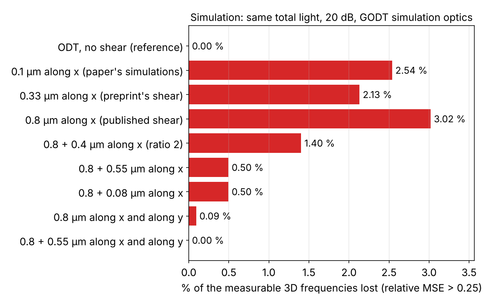
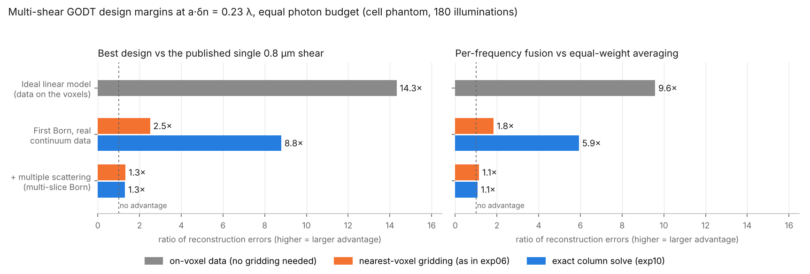

# Multi-shear gradient optical diffraction tomography: a simulation study

[](https://github.com/tomasG1414/godt-research-wiki/actions/workflows/ci.yml)

Gradient optical diffraction tomography (GODT) is a recent label-free 3D microscopy method.
It measures how a cell bends light, by interfering the image with a copy of itself shifted by a
small distance (the shear), and reconstructs a 3D map of the cell's refractive-index *gradient*.
I simulated the published setup's 0.8 µm shear with monochromatic light and the paper's
simulation optics. At that shear the instrument cannot see detail with a period of 0.8, 0.4 or
0.27 µm along the shear, however much light it collects, and about 3 % of the 3D frequencies it
could otherwise measure are effectively lost.

I then worked out how to choose and combine several shears so that, in the model, nothing is
lost, and checked how much of the gain survives more realistic physics. Combining shears is an
established remedy in 2D lateral-shearing interferometry (Elster & Weingärtner, 1999;
summarised in [Tomioka et al., 2023](https://arxiv.org/abs/2309.16434)), and the GODT authors
name combining shear directions as future work. What this project adds is the 3D tomographic
version.

The repository holds a tested NumPy/SciPy simulation library, eleven scripts that print the
numbers quoted in the wiki (CI re-runs the fast ones), and notes on 27 papers.
It is an independent project by Tomás Gantes Montero, a third-year physics undergraduate at
Universidad Europea de Valencia, made with Claude Code as an AI coding agent
([how](#how-this-was-made)).

It builds on J. Winnik *et al.*, *Communications Physics* 8, 510 (2025),
[doi:10.1038/s42005-025-02416-3](https://doi.org/10.1038/s42005-025-02416-3).
I am not affiliated with the paper's authors, and they have not endorsed this work.

## Results



*Share of the 3D frequencies the instrument can measure that are effectively lost (relative
mean-squared error above 0.25), for single and combined shears at the same total light and
20 dB, with the GODT paper's simulation optics. Generated by `lab/exp03_ewald_fisher.py`.*

1. A single 0.8 µm shear loses 3.02 % of the measurable volume: three planes of detail at
   0.8, 0.4 and 0.27 µm along the shear, plus the plane of structure that does not vary along
   the shear at all. A second direction at the same shear (0.8 µm along x and y), which is
   what the GODT authors name as future work, cuts the loss to 0.09 %. What remains lies where
   both directions are blind at once, and adding a second magnitude whose ratio to the first
   is not a ratio of small integers (0.55 µm) removes it. A pair of magnitudes along one
   direction only gets to 0.50 %, because neither magnitude sees structure that does not vary
   along the shear.
2. GODT's finite-shear factor multiplies the ODT spectrum point by point (Eq. 20 of the
   paper), so the information separates exactly into a shear part and a tomography part,
   `J(K) = ρ · S_t(K⊥) · M(K)`, and searching for the best design is cheap. In this model the
   best single shear is `Δ ≈ 2π/K_max = λ/(NA_det + NA_ill)`, about 0.20 µm, which is roughly
   the lateral resolution limit. That assumes coherent, monochromatic light; lower spatial
   coherence favours smaller shears.
3. The channels have to be combined frequency by frequency, each weighted by its
   information. That is standard inverse-variance (joint least-squares) fusion. Averaging the
   per-channel reconstructions instead is 9.6–21× worse in the linear model (two phantoms).
4. The gains shrink as the model gets more realistic, and the reason matters. In the linear
   model the best design beats the published single shear by 14.3× in reconstruction error.
   On realistic data reconstructed with the usual nearest-voxel gridding that falls to 2.5×,
   but most of that drop is the gridding: solving each axial-frequency column exactly, with
   no gridding at all, brings it back to 8.8×. The weighting advantage from item 3 goes
   9.6× → 1.8× → 5.9× over the same steps. Multiple scattering at the edge of the
   weak-scattering regime (aδn = 0.23λ) then cuts both to 1.3× and 1.1× with either
   reconstruction, and at twice that contrast they are gone. Past that point multiple
   scattering, not the reconstruction or the shear design, sets the error.
5. The multiple-scattering numbers are checked against an exact solver. A convergent Born
   series solver of the full Helmholtz equation reproduces the exact (scalar Mie) solution
   for a sphere to 0.4 %, where first-order Born theory is off by 80 %. It showed that an
   earlier 50 % gap between my wave-propagation model and Born theory came from comparing
   two different simulation windows plus a known obliquity factor, which holds to 0.1 % once
   the windows match. It also showed that the earlier multiple-scattering correction had
   the right size but the wrong structure. A multi-slice Born model gets that correction to
   within 4–10 % up to aδn = 0.46λ, on the rays where the exact solver can judge it, and
   gives the numbers in item 4. Every cheap model fails at 0.92λ.
6. The blind planes are set by the shear alone. The shear difference is linear in the
   measured Rytov field (the log of the field), so the data vanish on those planes however
   the light was scattered. This holds for monochromatic light, a uniform and
   calibrated shear, and no wrapping of the phase difference, and reading the planes as lost
   object detail assumes a first-order reconstruction.



*Item 4 at aδn = 0.23λ: how much the best design and per-frequency fusion gain, from the
ideal linear model to realistic data and multiple scattering, with each reconstruction.
Generated by `lab/exp11_exact_design.py`.*

The six experiment notes in `wiki/notes/` each end with a section on what they do not
establish, and [`wiki/projects/godt.md`](wiki/projects/godt.md) lists the main limitations in
one place.

## What's in the repository

- `lab/shearlib.py`: a NumPy/SciPy library with the shear transfer functions, 3D Ewald-sphere
  sampling with a closed-form sampling density, convex optimal-design solvers with an
  optimality certificate, two multi-slice forward models (wave propagation and multi-slice
  Born), an exact iterative Helmholtz solver (convergent Born series) with the scalar Mie
  series to check it against, and a reconstruction that needs no Fourier-space gridding.
  Its selftest checks the core formulas against closed forms, brute force and each other.
- Eleven experiment scripts (`lab/exp01`–`exp06`, `exp05b`, `exp08`–`exp11`), each
  deterministic or seeded, each printing the numbers quoted in the wiki. On every push, the
  tests in `tests/` run exp01–03 and exp05b and check the lost-volume and fusion numbers
  this README quotes. exp06 and exp09–11 take 10–45 minutes and several GB each, so CI
  runs only their building blocks (selftest and unit tests), not the scripts.
- Notes on 27 papers in `wiki/sources/` (28 pages, because the GODT preprint and the published
  paper have one each), linked to concept pages and to the derivations and experiment
  write-ups in `wiki/notes/`. The notes behind the results are
  [blind spots](wiki/notes/finite-shear-null-experiment.md),
  [choosing and combining shears](wiki/notes/multishear-fusion-design-solution.md),
  [realistic physics](wiki/notes/multiple-scattering-check.md),
  [an exact referee](wiki/notes/full-wave-referee.md) and
  [gridding and the forward model](wiki/notes/gridding-and-forward-model.md).

Tools: Python, NumPy, SciPy (SLSQP, HiGHS), Matplotlib, pytest, GitHub Actions, the OpenAlex API,
Markdown and LaTeX in Obsidian, Claude Code.

Two of the errors I caught along the way: a centring-phase convention that wrecked the
multiple-scattering reconstruction while looking exactly like a physics result, and a test
phantom without a band-pass filter, which made my first null-recovery experiment conclude the
opposite of the truth. The full list is under "Gotchas" in [`lab/README.md`](lab/README.md),
and the dated [audit] notes in
[`multishear-fusion-design-solution.md`](wiki/notes/multishear-fusion-design-solution.md)
record where I re-ran everything and corrected earlier claims. The November follow-up
added a third kind: a comparison between two forward models that differed mainly in their
simulation windows, which looked exactly like a physics gap
([`multiple-scattering-check.md`](wiki/notes/multiple-scattering-check.md) keeps the original
claim with its audit notes).

## How this was made

I chose the question, picked the papers, set the modelling assumptions and baselines, and
designed each experiment. I used Claude Code, an AI coding agent, throughout: it drafted most
of the paper summaries and wiki prose, and wrote much of the code in `lab/` to my
specifications. [`CLAUDE.md`](CLAUDE.md) is the configuration I wrote for it, which makes it
cite a source for every claim and mark anything else as inference.

The results in the wiki come from deterministic or seeded scripts. I re-ran exp01–exp08
myself and can walk through any derivation or number from them. The work was done between
July and October 2026; this public copy starts from a single commit.

In November 2026 I gave Claude Code an open brief to extend the project, and it chose the
two open items that most weakened the results above: the forward-model gap and the gridding
error. It wrote and ran exp09–exp11 and the solver code behind them, and drafted the two
notes that report them ([full-wave referee](wiki/notes/full-wave-referee.md),
[gridding and forward model](wiki/notes/gridding-and-forward-model.md)). Those scripts
print every number the notes quote. I have not re-run them yet.

## Running it

Python 3.10 or newer.

```bash
pip install -r lab/requirements.txt
cd lab
python shearlib.py              # selftest, should print "shearlib selftest OK"
python exp01_shear_nulls.py     # each expNN script prints the numbers quoted in the wiki
cd .. && pip install pytest && pytest -q    # unit tests and the README's numbers, ~1 min
```

Figures go to `lab/out/` (gitignored, so re-run to regenerate). Rough run times on a laptop:
exp01–02 a few seconds, exp03 ~20 s, exp05b and exp08 under a minute, exp05 ~2 min, exp04
~4–6 min, exp10 ~10 min, exp06 ~20–30 min, exp09 and exp11 ~45 min each. exp06, exp09 and
exp11 also need more than 6 GB of free memory.
`lab/requirements-ingest.txt` adds PyMuPDF for the PDF-to-text helper; no result depends on it.

## Layout

```
README.md       this page
lab/            numerical experiments (Python); see lab/README.md
  shearlib.py   shared maths with a selftest; the experiments build on it
wiki/           the notes (Markdown with [[wikilinks]] and LaTeX; opens as an Obsidian vault)
  projects/     godt.md: goal, background, results, limitations, next steps
  notes/        derivations and experiment write-ups
  concepts/     ODT, Rytov, missing cone, shearing interferometry, ...
  sources/      one page per paper
tools/          stdlib-only helpers: search.py (BM25 over the wiki), lint.py (link check)
tests/          pytest: selftest, unit tests, README numbers (run in CI)
raw/            put your own copies of source PDFs here (gitignored, not distributed)
REFERENCES.md   every summarised paper with its DOI or arXiv link
CLAUDE.md       configuration for the AI agent that helps maintain the wiki
```

On GitHub, the `[[double-bracket]]` names in the wiki are Obsidian links and show as plain
text. Each one is the file of that name under `wiki/`, and `REFERENCES.md` maps source pages
to papers.

## Sources and copyright

No paper full texts are included. `wiki/sources/` holds summaries and commentary with short,
attributed quotations; full bibliographic details are in [`REFERENCES.md`](REFERENCES.md).

## Licence and citing

Code: MIT ([`LICENSE`](LICENSE)). Written content and figures: CC BY 4.0
([`LICENSE-CONTENT.md`](LICENSE-CONTENT.md)). Quoted excerpts remain the property of their
authors. See [`CITATION.cff`](CITATION.cff), and please also cite the original GODT paper:
J. Winnik *et al.*, *Communications Physics* **8**, 510 (2025).

---
Tomás Gantes Montero · third-year physics undergraduate, Universidad Europea de Valencia ·
[tomas.gantes@gmail.com](mailto:tomas.gantes@gmail.com)
