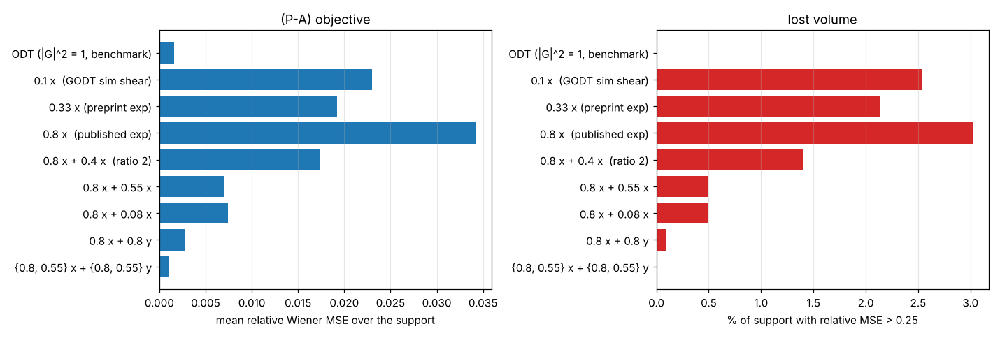

# Multi-shear gradient optical diffraction tomography — a simulation study

[](https://github.com/tomasG1414/godt-research-wiki/actions/workflows/ci.yml)

**In brief.** An independent student project (BSc Physics, 3rd year, Universidad Europea de Valencia).
Gradient optical diffraction tomography (GODT) is a recent label-free 3D microscopy method:
it measures how a cell bends light and reconstructs a 3D map of its refractive-index *gradient*.
At the shear (the small image offset the instrument relies on) used in the published experiment,
the instrument is blind to a few specific detail sizes. Using simulations only, I show that
combining two or more well-chosen shears recovers them, work out how to choose and fuse them,
and test how much of that survives more realistic physics. The GODT paper names combining
shear orientations as future work; this project explores that direction in simulation.

Builds on Winnik *et al.*, *Communications Physics* 8, 510 (2025),
[doi:10.1038/s42005-025-02416-3](https://doi.org/10.1038/s42005-025-02416-3).
Not affiliated with or endorsed by the authors of that paper.

## Main results



*Right: share of the measurable 3D frequency volume that is effectively lost (relative mean-squared
error above 0.25) at equal photon budget and 20 dB. A single 0.8 µm shear loses 3 %; adding a second,
non-commensurate magnitude and a second direction brings it to zero. The small 0.1 µm shear has no
nulls but loses 2.5 % to its blind slab. Left: the mean reconstruction error for the same designs
(the ODT bar is a reference level, and scores close to the best designs only under the model's noise
assumption). Generated by `lab/exp03_ewald_fisher.py`.*

- **Blind spots.** At 0.8 µm shear, three spatial frequencies along the shear (planes in 3D) are
  lost at any signal-to-noise ratio; with their surroundings and the single direction's blind plane,
  3 % of the measurable volume is effectively lost at 20 dB. A second shear whose ratio to the first
  is not a ratio of small integers fills them; a second direction fixes the remaining blind plane.
- **A design rule.** The information separates exactly as `J(K) = ρ · S_t(K⊥) · M(K)`
  (shear design × tomographic geometry), which makes optimal design cheap. The best single shear
  is `Δ ≈ 2π/K_max`: as large as possible without letting the nulls into the band.
- **Fusion.** Weighting each frequency by its information beats an equal-weight average of
  per-channel reconstructions by 10–21× in the linear model (two phantoms). This is standard
  inverse-variance fusion, and the margin shrinks to 1.8× with realistic gridding and ~1.1×
  once multiple scattering is included at the first-Rytov validity bound.
- **Robustness.** The positions of the nulls are exact under multiple scattering (shearing is
  linear in the measured field); the size of the gains is not. Shear calibration error, not photon
  count, is likely to limit the finest detail.

Caveats, and what is *not* established, are in [`wiki/projects/godt.md`](wiki/projects/godt.md)
and each note's "What this does not establish" section.

## What I built

- `lab/shearlib.py`: a ~1,200-line NumPy/SciPy library: shear transfer functions, 3D Ewald-sphere
  sampling with a closed-form sampling density, convex optimal-design solvers with an optimality
  certificate, and a wave-propagation (multiple-scattering) forward model. Its selftest checks the
  invariants against closed forms and brute force, and runs in CI.
- Eight experiment scripts (`lab/exp01`–`exp06`, `exp05b`, `exp08`), each seeded, each printing
  the numbers quoted in the wiki.
- A literature review of 27 papers in `wiki/sources/`, cross-linked with concept pages and
  derivations in `wiki/notes/` (start with [`wiki/projects/godt.md`](wiki/projects/godt.md)).

**Errors I caught along the way** are listed under "Gotchas" in [`lab/README.md`](lab/README.md),
and the dated **[audit]** notes in
[`multishear-fusion-design-solution.md`](wiki/notes/multishear-fusion-design-solution.md)
record where I re-ran everything and corrected my own earlier claims.

## How this was made

I chose the question, selected the papers, set the modelling assumptions and baselines, and
designed each experiment. I used Claude Code as a writing assistant throughout: it drafted most
of the paper summaries and wiki prose from our discussions, and wrote much of the code in `lab/`
to my specifications. I checked results by re-running every script against the closed-form
predictions, and I can walk through any derivation or number here. `CLAUDE.md` is the agent
configuration I wrote for maintaining the wiki.

## Running it

Python 3.10+.

```bash
pip install -r lab/requirements.txt
cd lab
python shearlib.py              # should print "shearlib selftest OK"
python exp01_shear_nulls.py     # each expNN script prints the numbers quoted in the wiki
```

Figures go to `lab/out/` (gitignored, so re-run to regenerate). Rough run times on a laptop:
exp01–02 a few seconds, exp03 ~20 s, exp08 ~30 s, exp05 ~1–3 min, exp04 ~4 min, exp06 ~20–30 min.

## Layout

```
README.md       this page
lab/            numerical experiments (Python); see lab/README.md
  shearlib.py   shared math with a selftest; the experiments build on it
wiki/           the notes (Markdown with [[wikilinks]] and LaTeX; opens as an Obsidian vault)
  projects/     godt.md: goal, results, next steps  ← start here
  notes/        derivations and experiment write-ups
  concepts/     ODT, Rytov, missing cone, shearing interferometry, ...
  sources/      one page per paper
tools/          stdlib-only helpers: search.py (BM25 over the wiki), lint.py (link check)
tests/          pytest wrapper around the selftest (run in CI)
raw/            put your own copies of source PDFs here (gitignored, not distributed)
REFERENCES.md   every summarised paper with DOI / arXiv link
CLAUDE.md       configuration for the AI agent that helps maintain the wiki
```

## Sources and copyright

No paper full texts are included. `wiki/sources/` holds summaries and commentary with short,
attributed quotations; full bibliographic details are in [`REFERENCES.md`](REFERENCES.md).

## Licence and citing

Code: MIT ([`LICENSE`](LICENSE)). Written content: CC BY 4.0 ([`LICENSE-CONTENT.md`](LICENSE-CONTENT.md)).
Quoted excerpts remain the property of their authors. See [`CITATION.cff`](CITATION.cff), and please
also cite the original GODT paper: J. Winnik *et al.*, *Communications Physics* **8**, 510 (2025).

---
Tomás Gantes Montero · BSc Physics, Universidad Europea de Valencia
